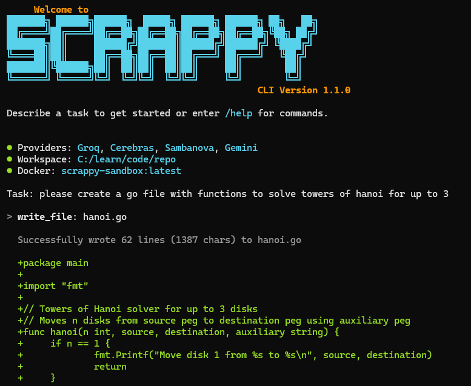

# Scrappy

[](https://github.com/HakAl/scrappy/actions/workflows/tests.yml)
[](https://badge.fury.io/py/scrappy-ai)
[](https://opensource.org/licenses/MIT)

Scrappy is a terminal coding assistant that combines local codebase search with multiple LLM providers. Provider access terms differ and change: some offer free tiers, others limited-credit trials or require purchased credits. Check each provider's current terms.


*Scrappy previews proposed changes and requests human approval.*

## What You Get

- **Context-aware chat** - Find relevant code through a local semantic index.
- **Agent mode** - Use `/agent` for coding tasks with approval for file writes and commands.
- **Undo points** - Git-based checkpoints let you roll back agent runs.
- **Provider failover** - Route requests across configured providers when limits are reached.
- **Local search** - Indexing and semantic search run locally after the initial model download.
- **Session persistence** - The session is saved when you exit with `/quit` by default and can be resumed.

## Quick Start

### 1. Install

Use Python 3.11 or newer. A virtual environment is recommended:

```bash
# macOS/Linux
python3 -m venv venv
source venv/bin/activate
pip install scrappy-ai
```

```powershell
# Windows PowerShell
python -m venv venv
.\venv\Scripts\Activate.ps1
pip install scrappy-ai
```

`pip install scrappy-ai` installs the latest release published on [PyPI](https://pypi.org/project/scrappy-ai/). Installing from a clone of main includes unreleased changes.

### 2. Get a Provider Key

Chat and agent tasks need network access and at least one configured provider API key. Provider access terms differ and change: some offer free tiers, others limited-credit trials or require purchased credits. Check each provider's current terms at its console:

| Provider | Console |
|----------|---------|
| Cerebras | [cloud.cerebras.ai](https://cloud.cerebras.ai) |
| Groq | [console.groq.com](https://console.groq.com) |
| Gemini | [aistudio.google.com](https://aistudio.google.com) |
| SambaNova | [cloud.sambanova.ai](https://cloud.sambanova.ai) |

### 3. Run

```bash
cd your-project
scrappy
```

On a fresh configuration, setup first displays a Terms of Use notice: type `ok` to continue or `q` to quit. To use chat, continue setup and configure a provider key. Keys configured through the wizard are saved locally in `config.json` under the platform user configuration directory for `scrappy` (resolved by `platformdirs.user_config_dir`). Requests, including relevant code context, go to the configured LLM provider APIs; review their privacy policies before sending sensitive material.

Initial indexing needs an embedding model download. The BGE-small model download was about 67 MB when observed; download sizes can change. Once the model is available, code indexing and search run locally.

## Commands

| Command | Purpose |
|---------|---------|
| `scrappy` | Start the interactive terminal UI |
| `scrappy version` | Show the installed version |
| `scrappy --resume` | Resume the last saved session |
| `scrappy --no-save` | Currently does not prevent saving on `/quit` (scrappy-u2go) |
| `scrappy undo [n]` | Undo the last N agent runs (default: one) |
| `scrappy undo --force` | Bypass the worktree path check for undo |
| `scrappy undo-list` | List undo points |
| `scrappy undo-gc --keep N` | Remove older undo points, keeping N |
| `/agent <task>` | Run a coding task with human approval |
| `/help` | Show interactive commands |
| `/clear` | Clear conversation history |
| `/quit` | Exit |

For example, ask "How does authentication work?" in chat, or enter `/agent add input validation to the signup form` for a coding task. Review proposed changes before approving them.

Chat and `/agent` require network access and a configured provider key. `/session save` and `/session load` are not currently supported (scrappy-9853). History cleared with `/clear` may reappear after restarting (scrappy-pz9l). `--no-save` currently does not prevent saving on `/quit` (scrappy-u2go).

See the [CLI reference](docs/CLI.md) for more commands and the [architecture overview](docs/ARCHITECTURE.md) for how indexing, retrieval, and orchestration fit together.

## Requirements

- Python >=3.11; CI tests Python 3.11, 3.12, and 3.13 on Linux, Windows, and macOS.
- Git for undo operations.
- Network access for model downloads and provider API requests.

## Troubleshooting

**No API keys configured:** Start the setup wizard and configure at least one provider key.

**Rate limit exceeded:** Check your provider's current quota, wait for it to reset, or configure another provider.

**Slow initial indexing:** Large codebases take time to index. Later runs update the index incrementally.

**Model download fails:** Check connectivity to Hugging Face, which hosts the embedding model.

## Contributing

See [CONTRIBUTING.md](CONTRIBUTING.md) for development guidelines and [RELEASING.md](docs/RELEASING.md) for the maintainer release process.

## Disclaimer

Review generated changes and work from a clean Git state so you can recover when needed. Checkpoints supplement your own backups and version control.

## License

MIT License. Use it, modify it, share it.
